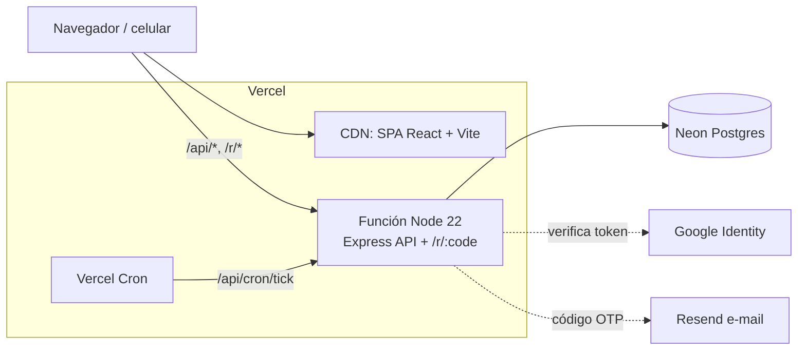

# 🏮 Kaonashi — Plataforma phygital

Restaurante japonés de alta gama donde el marketing físico (portavasos, flyers, table tents, cajas para llevar, eventos) lleva a los clientes por un QR firmado hasta pedidos y reservas. Cada paso queda atribuido y medido.

**Despliegue en Vercel:** sigue [`docs/DEPLOY_VERCEL.md`](docs/DEPLOY_VERCEL.md).

## Qué incluye

- **Login real y seguro**
  - Personal: usuario y contraseña (scrypt), sesiones guardadas en Postgres y revocables, bloqueo progresivo tras 5 intentos fallidos (429 + `Retry-After`), roles con permisos verificados en el servidor en cada ruta.
  - Clientes: código de 6 dígitos por e-mail (Resend, o buzón simulado en demo) y **Google** (Google Identity Services, token verificado en el servidor). Comprar como invitado siempre funciona.
  - Cerrar sesión revoca la sesión en el servidor y sincroniza las demás pestañas.
- **Análisis de datos** (`/admin/analytics`): todo se calcula con SQL sobre los registros crudos.
  - **Ventas y demanda:** ingresos diarios BTL vs orgánico, mapa de calor día × hora con cocineros sugeridos, matriz BCG del menú con acción sugerida, ingresos por categoría.
  - **Marketing BTL:** embudo de 9 etapas, ROAS y ROAS neto, costo por pedido, ranking de puntos de contacto con etiqueta Escalar / Mejorar landing / Detener, escaneos por tipo de pieza, mapa de calor de escaneos, rendimiento de cupones, modelo de atribución de primer o último toque.
  - **Clientes:** segmentos RFM, CLV, retención por cohorte mensual, nuevos vs recurrentes, mejores clientes con datos enmascarados.
  - **Inventario:** días de cobertura, pronóstico de 7 días (promedio ponderado de los últimos 4 días iguales de la semana), cantidad y fecha de pedido, riesgo de merma por lote.
  - Filtros por rango de fechas y exportación CSV de cada vista (con defensa contra inyección de fórmulas).
- **Histórico de demostración grande:** al primer arranque se generan ≈120 días con unos 15.000 pedidos, 22.000 escaneos de QR, 67.000 eventos del embudo, 2.000 clientes y 4.400 leads. El embudo se simula sesión por sesión, así que las cifras de escaneo, leads, pedidos, ingresos y ROAS son coherentes entre sí. La generación es determinista (semilla fija).
- **Circuito BTL completo:** QR firmado (HMAC) → landing → lead y cupón en billetera → menú → checkout con precios recalculados en el servidor → cocina (KDS) → seguimiento en vivo → embudo.

## Arquitectura



| Carpeta | Contenido |
| :--- | :--- |
| `src/server/app.ts` | API Express: auth, pedidos, cupones, QR, analíticas, exportaciones |
| `src/server/security.ts` | Sesiones, permisos, límites de intentos, auditoría encadenada, OTP, Google |
| `src/server/analytics.ts` | Consultas SQL de ventas, BTL, clientes e inventario |
| `src/server/store.ts`, `db.ts` | Almacén de documentos JSONB sobre Postgres (Neon en Vercel, PGlite en local) |
| `src/server/seed.ts` | Generador del histórico de demostración |
| `src/pages/admin/DataAnalytics.tsx` | Página de análisis de datos |
| `src/pages/auth/*` | Login de personal y de clientes |
| `scripts/build-vercel.mjs` | Empaqueta todo en `.vercel/output` |
| `dev-server.ts` | Servidor local (misma API + Vite) |

Los datos viven en una tabla `docs (collection, id, data jsonb)` con índices de expresión en los campos que se consultan (fecha y estado de pedidos, código de cupón, e-mail del cliente, etc.), más tablas propias para sesiones, límites de intentos, códigos de acceso y auditoría.

## Correr en local

```bash
npm install --legacy-peer-deps
npm run dev          # http://localhost:3000 — sin configurar nada
```

Sin `DATABASE_URL` se usa un Postgres embebido (PGlite) guardado en `./.data/pglite`. Para usar Neon desde local, define `DATABASE_URL`.

### Cuentas de demostración

Solo si **no** definiste `ENV_MASTER_SEED` / `DEMO_STAFF_PASSWORD` (en un despliegue público, defínelas):

| Rol | Usuario | Contraseña | Ve |
| :--- | :--- | :--- | :--- |
| Sysmaster | `kaonashi_sysmaster` | `KaonashiMaster2026!` | Todo |
| Cocina (Itamae) | `itamae_lead` | `ItamaeKitchen2026!` | KDS, menú (86), inventario |
| Marketing | `marketing_lead` | `BtlMarketing2026!` | Campañas, QR, analítica BTL y clientes |
| Operaciones | `ops_lead` | `OpsLogistics2026!` | Pedidos, reservas, ventas, inventario |
| Recepción | `reception_lead` | `HostReception2026!` | Pedidos, reservas, canje en barra |

Clientes: `/account/login` → "Google (SIMULADO)" o cualquier e-mail (el código aparece en pantalla).

## Verificación

```bash
npm run typecheck                         # TypeScript sin errores
npm test                                  # 14 pruebas: precios, QR, CSV, i18n, seguridad e integración con Postgres
npm run verify                            # circuito BTL completo contra la app en marcha (11 comprobaciones)
npx tsx scripts/security-smoke-test.ts    # fuerza bruta, permisos, QR alterado, exportaciones
npx tsx scripts/verify-app.ts             # rutas en ES/EN/JA y 4 monedas
```

Los scripts aceptan `APP_BASE_URL` para probar un despliegue.

## Seguridad (resumen)

- Toda ruta de administración exige sesión de personal y el permiso del rol; un acceso denegado responde 403 y queda auditado.
- Precios, descuentos, impuestos y stock se recalculan en el servidor dentro de una transacción; los montos enviados por el cliente se ignoran.
- La mesa solo se acepta desde el QR firmado; una mesa escrita a mano queda en `pending_confirmation`.
- Cupones: validez, tope total, límite por cliente y canje atómico (20 canjes simultáneos con tope 5 → exactamente 5).
- Límites: login, OTP, pedidos (5/h por teléfono, 10/h por IP), leads, escaneos, eventos y chat.
- Auditoría append-only encadenada con SHA-256 y verificación de integridad.
- Los secretos que falten en desarrollo se generan una vez y se guardan en la base; en producción la app no arranca sin ellos.

## Estado y pendientes

Hecho: login de personal y clientes, protección de la API, Postgres (Neon/PGlite), histórico grande, análisis de datos, panel ejecutivo con datos reales, despliegue en Vercel.

Pendiente o simulado:

- **Pagos:** Stripe no está conectado; el pago en línea es simulado y el pago en el local queda `unpaid`.
- **TOTP (MFA) del personal:** no implementado; las cuentas usan solo contraseña.
- **Correos y Google** funcionan de verdad solo al configurar `RESEND_API_KEY` y `GOOGLE_CLIENT_ID`.
- **Pantallas heredadas de la versión de AI Studio:** Personalización visual, Centro de Datos y Generador de QR conservan su interfaz original; sus llamadas a la API ya están protegidas, pero no se auditaron a fondo.
- **Instalación:** `npm install` necesita `--legacy-peer-deps` por un conflicto de versiones entre Vite 8 y esbuild (ya configurado en `vercel.json`).
