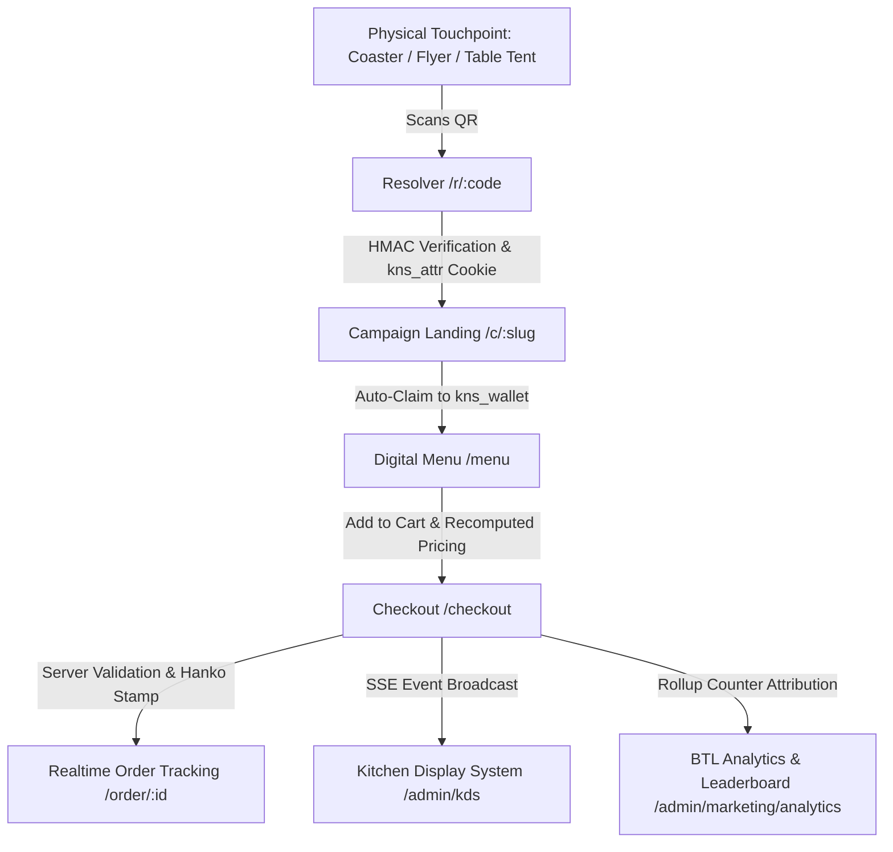

# 🏮 Kaonashi Phygital Platform — Master Build v7

Kaonashi is a high-end Japanese and sushi-fusion restaurant phygital activation engine. Below-The-Line (BTL) marketing in the physical world (flyers, table tents, coasters, takeaway boxes, pop-up events, street teams) drives guests via signed QR codes into a contextual mobile web experience that converts directly into orders, reservations, and loyalty rewards—with end-to-end attribution.

---

## 🏗️ Architecture Overview



---

## 🚀 Quickstart & Zero-Config Boot

The application runs with **zero mandatory secrets** in development. On first boot, demo data seeds automatically:

```bash
# 1. Install dependencies
npm install

# 2. Start the full-stack server (Node Express + Vite)
npm run dev

# 3. Run unit tests
npm test

# 4. Run BTL Loop Verification Script
npx tsx scripts/verify-btl-loop.ts
```

The app will be accessible at `http://localhost:3000`.

---

## 👥 Demo Staff Credentials (§10.1)

| Role | Username | Password | Permitted Scope |
| :--- | :--- | :--- | :--- |
| **Sysmaster** | `kaonashi_sysmaster` | `KaonashiMaster2026!` | Full administrative access, audit log, price editing |
| **Kitchen Manager (Itamae)** | `itamae_lead` | `ItamaeKitchen2026!` | KDS operations, 86 stock toggle, prep times |
| **Marketing Manager** | `marketing_lead` | `BtlMarketing2026!` | BTL campaigns, QR wizard, lead capture, analytics |
| **Ops Sub-Admin** | `ops_lead` | `OpsLogistics2026!` | Logistics, orders, table reservations |
| **Reception / Host** | `reception_lead` | `HostReception2026!` | In-person coupon redemption, table check-in |

---

## 🗺️ Routing Map (§4)

- `/`: BTL-aware homepage with hero and branch status
- `/menu`: Digital menu with dietary & allergen filters, dish cards, modal detail
- `/checkout`: Checkout with table detection, takeaway, delivery, and Hanko seal confirmation
- `/order/:id`: Live 5-stage order tracker with SSE updates and stylized delivery map
- `/reservations`: Interactive SVG floor plan with numbered counter seats and deposit
- `/rewards`: Loyalty tiers (Nigiri Explorer, Itamae VIP, Omakase Master), animated ensō ring, secret menu
- `/c/:slug`: BTL campaign landing page with perforated ticket and lead capture
- `/r/:code`: Cryptographic QR resolver (HMAC-SHA256)
- `/redeem`: Customer manual promo code redemption
- `/u/:token`: One-click unsubscribe and GDPR data erasure
- `/login`: Staff portal login with rate-limiting protection
- `/admin/dashboard`: Executive KPI row, demand heatmap 7x24, CLV segments, BCG matrix
- `/admin/kds`: Real-time Kitchen Display System with SLA colors and To-Confirm lane
- `/admin/marketing/campaigns`: Campaign management, touchpoints, distribution logs, cost entries
- `/admin/marketing/qr`: 5-step QR generator wizard with live preview and SVG export
- `/admin/marketing/analytics`: 10-stage funnel and touchpoint leaderboard with Scale/Fix/Stop tags
- `/admin/redeem`: In-person coupon validation with bill amount input and walk-in attribution
- `/admin/menu`: Catalog editing, price modifications with before/after audit, 86 toggle
- `/admin/settings/branding`: Kyoto Zen, Tokyo Neon, Edo Tradition, Osaka Minimal themes
- `/admin/audit`: Append-only hash-chained audit log viewer with cryptographic verification

---

## 🛡️ Security Guarantees (OWASP Top 10)

1. **Centralized RBAC**: Enforced via `authorize(ctx, permission, resource)` choke point.
2. **Pricing Integrity**: Server completely recomputes cart lines, taxes, and discounts from database prices.
3. **Audit Log Chain**: Each entry is hashed via `SHA-256(prevHash + canonicalJSON)` with a verification engine.
4. **QR Durability**: Cryptographic HMAC signature covers `v1|shortCode|touchpointId`, allowing campaign dates, destinations, and limits to be modified without reprinting physical collateral.
5. **Rate Limiting**: Sliding window protection against brute-force and scraping.

---

## 📋 Phase Status & Next Steps

- **Phase 1: Scan-to-Order BTL Core Loop**: **100% COMPLETE & VERIFIED**
  - Proven by `scripts/verify-btl-loop.ts`, `scripts/verify-app.ts`, and `scripts/security-smoke-test.ts`.
  - All acceptance criteria tagged [P1] pass.
- **Phase 2 & 3 Enhancements**:
  - Live Gemini API Concierge streaming drawer.
  - Live Stripe Elements integration when keys provided.
  - Native Excel `.xlsx` multi-sheet imports and exports via Data Hub.
